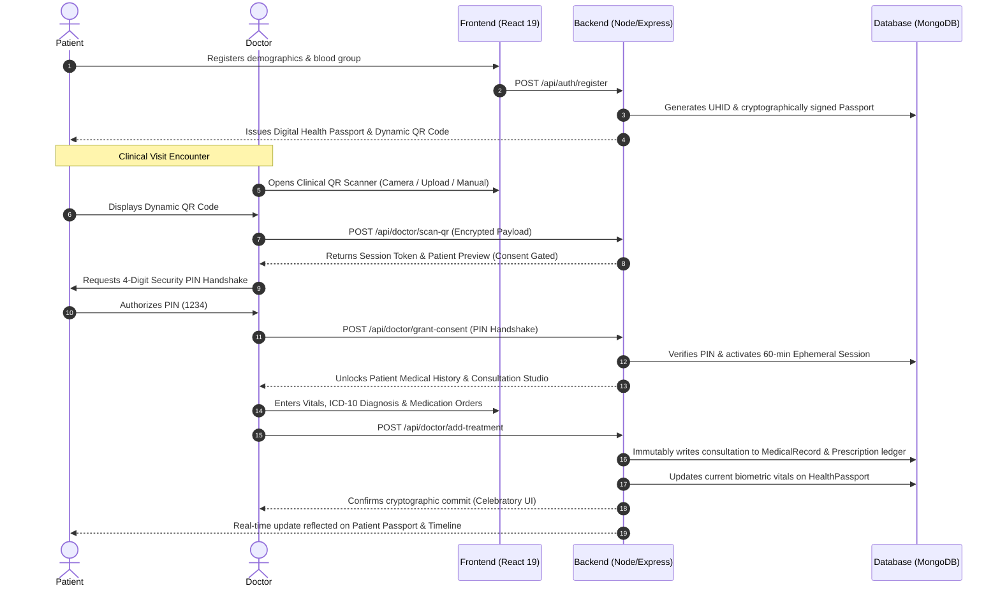

# QR HEALTH PASSPORT 🏥

> **Consent-Governed Universal Health ID (UHID) & Digital Health Passport Ecosystem**  
> Built strictly using the **MERN Stack** (MongoDB, Express, React 19, Node.js) with independent backend and frontend architectures.  
> 🔗 **GitHub Repository**: [https://github.com/Parasharamg63/QR-HEALTH-PASSPORT.git](https://github.com/Parasharamg63/QR-HEALTH-PASSPORT.git)  
> 🌿 **Active Branches**: `main` (Production) & `dev` (Active Integration)  
> 👥 **Team Collaborators**: `Parasharamg63`, `srushtimamatha10@gmail.com`, `thrupthis022@gmail.com`  
> 🔀 **Open a Pull Request**: [Create Pull Request on GitHub](https://github.com/Parasharamg63/QR-HEALTH-PASSPORT/compare)

---

## 📑 Table of Contents

- [Overview](#-overview)
- [Key Architectural Features](#-key-architectural-features)
  - [1. Multi-Language Localization Engine (i18n)](#1-multi-language-localization-engine-i18n)
  - [2. Multi-Tier Hardware-Accelerated QR Decoder](#2-multi-tier-hardware-accelerated-qr-decoder)
  - [3. Zero-Knowledge Consent Handshake Protocol](#3-zero-knowledge-consent-handshake-protocol)
  - [4. Clinical EHR Studio & Longitudinal Ledger](#4-clinical-ehr-studio--longitudinal-ledger)
  - [5. Humanized Healthcare UI System](#5-humanized-healthcare-ui-system)
  - [6. Independent Doctor Onboarding & Verification](#6-independent-doctor-onboarding--verification)
- [Core Clinical Workflow](#-core-clinical-workflow)
- [Pull Request & Contribution Guide](#-pull-request--contribution-guide)
  - [Branching Model](#branching-model)
  - [Step-by-Step PR Submission Workflow](#step-by-step-pr-submission-workflow)
  - [Standard Pull Request Template](#standard-pull-request-template)
  - [Review & Merge Guidelines for Collaborators](#review--merge-guidelines-for-collaborators)
- [System Architecture & Data Schemas](#-system-architecture--data-schemas)
- [REST API Reference](#-rest-api-reference)
- [Local Setup & Installation](#-local-setup--installation)
- [License & Collaborators](#-license--collaborators)

---

## 🏥 Overview

**QR Health Passport** is an enterprise-grade digital health identity and clinical consultation ecosystem designed to eliminate fragmented medical records, lost paper prescriptions, and unauthorized health data access.

The platform provides every citizen with a cryptographically verified **Universal Health ID (UHID)** and a dynamic, tamper-evident **QR Health Passport**. When seeking medical care, the patient presents their QR code to an attending physician. Decryption of confidential medical history is strictly guarded by an explicit **4-digit Patient PIN Consent Handshake**, granting time-bounded (60-minute ephemeral) access. Following consultation, the physician immutably logs biometric vitals, ICD-10 diagnoses, and medication prescriptions directly to the patient's permanent longitudinal ledger.

---

## 🌟 Key Architectural Features

### 1. Multi-Language Localization Engine (i18n)
To ensure accessibility across regional and national clinical environments, the platform features a zero-dependency, high-speed multi-language localization engine (`LanguageContext`):
- **Supported Languages**:
  - **English (`en`)**: Standard clinical terminology.
  - **Kannada (`kn` / ಕನ್ನಡ)**: Primary regional mother tongue for Karnataka healthcare centers.
  - **Hindi (`hi` / हिंदी)**: National language localization.
  - **Telugu (`te` / తెలుగు)**: Regional cross-border language support.
- **Instant Reactive Switching**: Zero page reload required; reactive context dynamically propagates through all components and forms.
- **Persistence**: Remembers patient and physician preference in `localStorage` (`health_passport_lang`) and sets document root attributes (`<html lang="...">`).
- **Accessible Everywhere**: Interactive language switcher dropdown is available on both the main navigation bar and the login/registration gateway.

### 2. Multi-Tier Hardware-Accelerated QR Decoder
Designed for real-world clinic conditions where phone screens might have glare, scratches, or high resolution:
- **Tier 1 (Native BarcodeDetector)**: Leverages browser hardware acceleration in modern Chromium and Android devices for sub-millisecond detection.
- **Tier 2 (jsQR Dual Inversion)**: Decodes normal and color-inverted QR codes directly on an off-screen HTML5 canvas.
- **Tier 3 (High-Resolution Downsampling)**: Automatically downsamples 4K smartphone screenshots to an 800px sweet spot, resolving zxing/multi-format reader failures.
- **Tier 4 (Contrast Binarization)**: Applies greyscale luminance thresholding (`0.299R + 0.587G + 0.114B`) to decode QR codes in low-light, overexposed, or angled photos.
- **3 Input Modalities**: Live video camera stream (with multi-camera device switching), direct image/screenshot file drop, and 14-digit manual UHID lookup.

### 3. Zero-Knowledge Consent Handshake Protocol
- **Privacy-First Access**: Doctors cannot view past diagnoses, lab reports, or sensitive notes simply by scanning the QR code.
- **Cryptographic PIN Handshake**: Decryption keys are issued only after the patient verbally or digitally authorizes a **4-digit Security PIN** (default test PIN: `1234`).
- **Ephemeral Access**: Consent tokens automatically expire after **60 minutes**, preventing unauthorized historical access after the consultation ends.

### 4. Clinical EHR Studio & Longitudinal Ledger
- **Biometric Telemetry Strip**: Real-time logging of Blood Pressure (`mmHg`), Pulse (`bpm`), SpO2 Oxygen (`%`), Blood Glucose (`mg/dL`), and Body Temp (`°F`).
- **Diagnostic Presets & ICD-10 Classification**: 1-click clinical presets (e.g. *Diabetic Review*, *Hypertension Review*) with ICD-10 classification codes (`E11.9`, `I10`).
- **Structured Medication Prescription Pad**: Multi-drug prescription builder with dosage, administration frequency (`1-0-1`, `1-0-0`, `1-1-1`, `0-0-1`, `SOS`), meal timing (`After Food`, `Before Food`, `Empty Stomach`), and special instructions.
- **HL7/FHIR International Standards**: Encounter ledger structured in chronological order with doctor credentials, hospital/clinic tags, and follow-up alerts.
- **Clinical Summary Export & Printing**: Printable wallet-sized smart card and consultation summary dialogs for physical patient documentation.

### 5. Humanized Healthcare UI System
- **Clean Clinical Aesthetics**: High-contrast, executive slate and healthcare teal palettes (`#00838C`, `#005F66`, `#E6F7F8`, `#F8FAFC`) with zero AI neon synthetic glowing artifacts.
- **High Readability**: System sans-serif typography (`'Plus Jakarta Sans'`, `-apple-system`) rendering Kannada (ಕನ್ನಡ) and Telugu (తెలుగు) scripts crisply.
- **Dark & Light Mode Support**: Instant toggle with contrast preservation across cards, modal dialogs, and consultation forms.

### 6. Independent Doctor Onboarding & Verification
- Dedicated **Doctor Registration Portal** capturing legal doctor name, professional email, medical license number (e.g. `KMC-48291-KA`), clinical specialization, hospital/clinic affiliation, and department.
- Automatically assigns clinical role privileges to scan QR passports, initiate consent handshakes, and record treatments.

---

## 🔄 Core Clinical Workflow



---

## 🔀 Pull Request & Contribution Guide

We welcome contributions from collaborators (`Parasharamg63`, `srushtimamatha10@gmail.com`, `thrupthis022@gmail.com`) and open-source contributors. Follow these instructions to ensure clean, verified pull requests.

### Branching Model

```
       [feature/login-i18n]  ----> (PR into dev) ----+
              ^                                      |
              |                                      v
main --------+-------------------------------------+--[Release v1.2]---> (Production)
              \                                    /
  dev --------+-----------------------------------+---------------------> (Integration)
```

- **`main` (Protected)**: Production-ready, stable codebase. Direct pushes are restricted; changes land via Pull Requests from `dev` after testing.
- **`dev` (Active Integration)**: Main working branch where all feature branches and pull requests are integrated and verified.
- **`feature/<feature-name>`**: Topic branch branched off `dev` for specific components, fixes, or enhancements (e.g. `feature/kannada-translations`, `feature/qr-scanner-fix`).

---

### Step-by-Step PR Submission Workflow

#### Step 1: Clone & Sync the Repository
```bash
# Clone the repository
git clone https://github.com/Parasharamg63/QR-HEALTH-PASSPORT.git
cd QR-HEALTH-PASSPORT

# Checkout the dev branch and pull the latest changes
git checkout dev
git pull origin dev
```

#### Step 2: Create a Dedicated Feature Branch
```bash
# Always branch off the latest 'dev' branch
git checkout -b feature/your-feature-name
```
*Naming Conventions*:
- `feature/...` for new features or UI additions
- `fix/...` for bug fixes or decoding patches
- `refactor/...` for code cleanup or performance improvements
- `docs/...` for documentation and README updates

#### Step 3: Implement Your Changes & Verify Build
Ensure zero compilation errors, broken imports, or console warnings:
```bash
# Test frontend production build
cd frontend
npm run build

# Test backend server startup
cd ../backend
node server.js
```

#### Step 4: Stage & Commit Using Semantic Commit Messages
```bash
git add -A
git commit -m "feat(i18n): add Kannada and Telugu localization dictionaries"
```
*Commit Prefix Guidelines*:
- `feat:` New features or capabilities
- `fix:` Bug fixes or decoding improvements
- `refactor:` Code refactoring without behavioral changes
- `style:` UI/CSS visual polish
- `docs:` Documentation updates
- `chore:` Dependency or build system updates

#### Step 5: Push Branch to GitHub
```bash
git push -u origin feature/your-feature-name
```

#### Step 6: Open the Pull Request on GitHub
1. Navigate to: [https://github.com/Parasharamg63/QR-HEALTH-PASSPORT/pulls](https://github.com/Parasharamg63/QR-HEALTH-PASSPORT/pulls)
2. Click **"New Pull Request"**.
3. Set **Base Branch**: `dev` ⬅️ **Compare Branch**: `feature/your-feature-name`.
   *(Or set Base Branch: `main` ⬅️ Compare Branch: `dev` when staging a release)*.
4. Fill out the **Pull Request Template** below with clear context.
5. Click **"Create Pull Request"**.
6. Request review from team members (`Parasharamg63`, `srushtimamatha10@gmail.com`, `thrupthis022@gmail.com`).

---

### Standard Pull Request Template

Copy and paste this template when opening a Pull Request:

```markdown
## 📌 Pull Request Overview

### 1. Summary of Changes
- [Brief description of what was added, changed, or fixed]

### 2. Clinical / Architectural Scope
- [ ] Patient Health Passport & Smart Card
- [ ] Doctor Clinical Consultation Form & Prescriptions
- [ ] QR Code Scanning & Hardware Decoding (Multi-tier)
- [ ] Consent Security Handshake & PIN Verification
- [ ] Multi-Language Localization (Kannada, Hindi, Telugu, English)
- [ ] Backend API / Mongoose Schemas / JWT Auth
- [ ] Documentation / Configuration

### 3. Key Changes Implemented
- **Component / Route**: `path/to/file.jsx` - [Description of edit]
- **Component / Route**: `path/to/file.js` - [Description of edit]

### 4. Verification & Testing Checklist
- [ ] `npm run build` completed with 0 errors in `frontend/`
- [ ] Backend API starts cleanly with MongoDB connected
- [ ] Tested in Google Chrome / Microsoft Edge
- [ ] Verified light/dark theme visual fidelity
- [ ] Tested multi-language switching (English, Kannada, Hindi, Telugu)
- [ ] Verified patient PIN consent handshake (1234)
- [ ] Confirmed no sensitive data decrypted without authorization

### 5. Screenshots / Visual Proof (If Applicable)
*(Attach screenshots or recordings of the UI changes here)*

### 6. Related Issues / Discussions
- Closes #[Issue Number] (if applicable)
```

---

### Review & Merge Guidelines for Collaborators

1. **Review Checklist**:
   - Verify that patient medical records remain protected by the consent handshake.
   - Confirm that all user-facing strings use `t('key')` from `LanguageContext`.
   - Ensure color schemes adhere to the clinical palette with no synthetic neon styles.
   - Check that `npm run build` succeeds without warnings.
2. **Merging Policy**:
   - Merge into `dev` branch first for validation.
   - Once thoroughly tested, create a PR from `dev` into `main` for release.
   - Use **"Squash and Merge"** or **"Rebase and Merge"** to maintain a clean linear git history.

---

## 🏛️ System Architecture & Data Schemas

```
QR-HEALTH-PASSPORT/
├── backend/
│   ├── config/
│   │   └── db.js                 # MongoDB connection logic
│   ├── middleware/
│   │   └── auth.js               # JWT verification & RBAC guard
│   ├── models/
│   │   ├── User.js               # Patient & Doctor user profiles
│   │   ├── HealthPassport.js     # Universal Health ID, dynamic QR token, vitals, allergies
│   │   ├── MedicalRecord.js      # Encounters, ICD-10 diagnosis, chief complaints, observations
│   │   ├── Prescription.js       # Medicines, dosage, frequencies, meal timing
│   │   └── ConsentSession.js     # Handshake sessions, 4-digit PIN, 60m expiry
│   ├── routes/
│   │   ├── authRoutes.js         # Patient & Doctor registration, login, profile
│   │   ├── passportRoutes.js     # Health Passport lookup, token regeneration
│   │   ├── doctorRoutes.js       # QR scan, consent verification, treatment commit
│   │   └── medicalRoutes.js      # Medical record history & prescriptions
│   ├── seed/
│   │   └── seedData.js           # Clinical seed datasets
│   ├── package.json
│   └── server.js                 # Express server entry point (Port 5000)
│
├── frontend/
│   ├── src/
│   │   ├── components/
│   │   │   ├── Navbar.jsx                  # Top navigation, language selector & theme toggle
│   │   │   ├── LoginPage.jsx               # Patient/Doctor auth tabs with native i18n
│   │   │   ├── HealthPassportCard.jsx      # Digital Passport, dynamic QR & vitals strip
│   │   │   ├── DoctorConsultationForm.jsx  # EHR treatment pad, vitals entry & prescription builder
│   │   │   ├── MedicalHistoryTimeline.jsx  # Chronological verified ledger
│   │   │   ├── QRScannerModal.jsx          # 4-tier camera/file/manual scanner
│   │   │   ├── ConsentModal.jsx            # 4-digit PIN consent authorization
│   │   │   └── ClinicalSummaryModal.jsx    # Consultation summary export dialog
│   │   ├── context/
│   │   │   ├── AuthContext.jsx             # JWT authentication & session state
│   │   │   ├── ThemeContext.jsx            # Light/Dark modern themes
│   │   │   └── LanguageContext.jsx         # Multi-language dictionary (en, kn, hi, te)
│   │   ├── services/
│   │   │   └── api.js                      # Centralized API service
│   │   ├── App.jsx                         # Main view router & workflow coordinator
│   │   └── main.jsx                        # React root wrapped in providers
│   ├── package.json
│   ├── tailwind.config.js
│   └── vite.config.js
│
├── .github/
│   └── PULL_REQUEST_TEMPLATE.md            # GitHub PR template auto-loaded on PR creation
├── start-dev.bat                           # 1-Click developer launcher
└── README.md                               # Complete platform documentation
```

---

## 📡 REST API Reference

### Authentication Endpoints (`/api/auth`)
| Method | Endpoint | Description | Access |
|---|---|---|---|
| `POST` | `/api/auth/register` | Register new Patient or Doctor | Public |
| `POST` | `/api/auth/login` | Login with email & password | Public |
| `GET` | `/api/auth/me` | Fetch authenticated session profile | Authenticated |

### Health Passport Endpoints (`/api/passport`)
| Method | Endpoint | Description | Access |
|---|---|---|---|
| `GET` | `/api/passport/:userId` | Retrieve patient Digital Health Passport | Patient / Doctor |
| `POST` | `/api/passport/refresh-token` | Regenerate dynamic cryptographic QR token | Patient |

### Doctor Clinical & Consent Endpoints (`/api/doctor`)
| Method | Endpoint | Description | Access |
|---|---|---|---|
| `POST` | `/api/doctor/scan-qr` | Decode scanned QR code / UHID & create session | Doctor |
| `POST` | `/api/doctor/grant-consent` | Verify patient 4-digit PIN & activate 60m session | Doctor / Patient |
| `GET` | `/api/doctor/patient-dossier/:patientId` | Unlocks patient medical history after consent | Doctor (Consent Verified) |
| `POST` | `/api/doctor/add-treatment` | Immutably commits diagnosis, vitals & prescription | Doctor (Consent Verified) |

### Medical Records Endpoints (`/api/medical`)
| Method | Endpoint | Description | Access |
|---|---|---|---|
| `GET` | `/api/medical/records/:patientId` | Fetch chronological clinical history | Authenticated |
| `GET` | `/api/medical/prescriptions/:patientId` | Fetch all historical prescriptions | Authenticated |

---

## 🚀 Local Setup & Installation

### Prerequisites
- **Node.js** (v18.0.0 or higher)
- **MongoDB** Community Server (installed locally on default port `27017` or MongoDB Atlas URI)
- **Git**

---

### Option 1: 1-Click Launch (Windows)
Double-click `start-dev.bat` in the repository root directory. It automatically:
1. Starts the MongoDB Daemon.
2. Starts the Node.js Express backend on `http://localhost:5000`.
3. Starts the Vite React frontend on `http://localhost:5173`.
4. Opens your default browser to the webapp.

---

### Option 2: Manual Launch (Step-by-Step)

#### 1. Start MongoDB
```bash
mongod --dbpath "D:\QR HEALTH PASSPORT\data\db" --port 27017
```

#### 2. Start Backend API Server
```bash
cd backend
npm install
node seed/seedData.js   # Optional: Seeds sample test patients and doctors
npm start
```
*Backend runs at `http://localhost:5000`*

#### 3. Start Frontend Development Server
```bash
cd ../frontend
npm install
npm run dev
```
*Frontend runs at `http://localhost:5173`*

---

### Quick Test Credentials

| Role | Email | Password | Security PIN | Details |
|---|---|---|---|---|
| **Patient** | `patient@example.com` | `password123` | `1234` | Rameshwar Gowda • UHID: `91-4421-8890-1204` |
| **Doctor** | `doctor@example.com` | `password123` | N/A | Dr. Rajesh Sharma, MD • KMC-48291-KA |

---

## 👥 License & Collaborators

- **Repository**: [https://github.com/Parasharamg63/QR-HEALTH-PASSPORT.git](https://github.com/Parasharamg63/QR-HEALTH-PASSPORT.git)
- **Author & Maintainer**: `Parasharamg63`
- **Collaborators**: `srushtimamatha10@gmail.com`, `thrupthis022@gmail.com`
- **License**: MIT License
